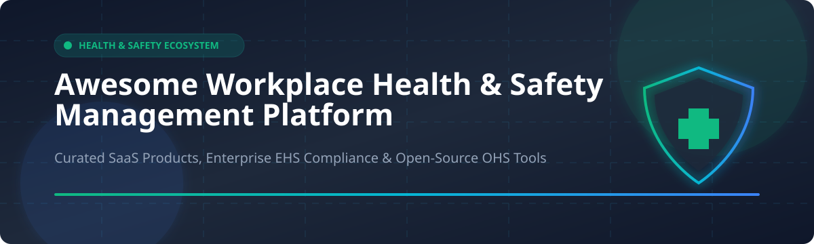

  

# 🛡️ Awesome Workplace Health & Safety Management (EHS)

  
  
  
  

> 🚀 A curated list of top **Workplace Health & Safety Management (EHS/OHS)** SaaS products, enterprise compliance platforms, and open-source GitHub projects.

📊 The **Environmental, Health, and Safety (EHS) & Workplace Safety Management Software Market** is estimated at **$8.5 Billion to $10.2 Billion in 2026** (projected to reach $14+ Billion by 2030 at a CAGR of ~10.5%). The sector is **moderately fragmented** — while massive CRM/cloud enterprise giants like Salesforce enter via dedicated modules, established multi-million and multi-billion EHS category leaders (Cority, VelocityEHS, Intelex) hold strong domain shares alongside specialized SaaS vendors (SafetyCulture) and regional compliance solutions.

---

## 📑 Table of Contents

- [💼 SaaS & Commercial Platforms](#-saas--commercial-platforms)
- [🔓 Open-Source GitHub Projects](#-open-source-github-projects)
- [🤝 How to Contribute](#-how-to-contribute)
- [💖 Support & Sponsorship](#-support--sponsorship)
- [⭐ Star History](#-star-history)
- [⚠️ Disclaimer](#%EF%B8%8F-disclaimer)

---

## 💼 SaaS & Commercial Platforms

| Platform | Key Features / Overview | Size (Revenue / Valuation) | Starting Pricing | Free Tier / Trial Limit |
| :--- | :--- | :--- | :--- | :--- |
| **[Salesforce Safety Cloud](https://www.salesforce.com/products/safety-cloud/)** | Employee wellness, emergency response, and automated safety compliance fully integrated into the Salesforce ecosystem. | **$41.5B Revenue** (Market Cap ~$270B) | Starts at **$50 per user/month** (Enterprise add-on) | **30-day free trial** with full feature sandbox access |
| **[SafetyCulture](https://safetyculture.com/)** | Mobile inspections, safety checklists (iAuditor), incident reporting, and real-time issue tracking. | **$1.7B Valuation** (~$150M ARR) | Starts at **$24 per user/month** (Premium tier) | **Free Plan**: Up to 10 users & 100 inspections/month |
| **[VelocityEHS](https://www.velocityehs.com/)** | Comprehensive EHS & ESG platform covering ergonomics, chemical safety (MSDSonline), industrial hygiene, and risk management. | **~$300M Revenue** ($1.5B+ Valuation) | Starts at **$2,500/year** (Small business base package) | **14-day free trial** (Chemical SDS search module) |
| **[Cority](https://www.cority.com/)** | Enterprise EHS, quality (QMS), occupational health, and environmental compliance software. | **~$250M Revenue** ($1.2B+ Valuation) | Starts at **$5,000/year** (Modular enterprise licensing) | **14-day guided sandbox demo** upon request |
| **[Intelex](https://www.intelex.com/)** | Incident tracking, ISO audits, regulatory compliance, and worker safety management. | **~$200M Revenue** (Acquired by Fortive for $570M) | Starts at **$3,000/year** (Core incident management tier) | **30-day trial sandbox** for qualified enterprise teams |
| **[Origami Risk](https://www.origamirisk.com/)** | Integrated safety management, worker compensation claims, environmental tracking, and risk control. | **~$180M Revenue** ($1.0B+ Valuation) | Starts at **$6,000/year** (Integrated risk tier) | **14-day interactive demo environment** |
| **[Alcumus](https://www.alcumus.com/)** | Contractor management (SafeContractor), EHS compliance, risk assessments, and supply chain safety. | **~$150M Revenue** ($800M+ Valuation) | Starts at **$1,200/year** (Vendor compliance tier) | **14-day demo access** with pre-configured risk templates |
| **[Benchmark ESG](https://www.benchmarkdigitalesg.com/)** | Operational risk, safety auditing, environmental sustainability, and ESG compliance management. | **~$120M Revenue** ($600M+ Valuation) | Starts at **$4,000/year** (Core EHS module) | **14-day trial** for select auditing and safety tools |
| **[EcoOnline](https://www.ecoonline.com/)** | Chemical management (Chemdoc), crisis management, safety inspections, and hazard identification. | **~$110M Revenue** ($700M+ Valuation) | Starts at **$1,500/year** (Chemical safety starter) | **14-day free trial** for SDS & Safety Inspection tools |
| **[Quentic](https://www.quentic.com/)** | EHS and ESG management software covering occupational safety, environmental hazards, and sustainability. | **~$80M Revenue** (Acquired by AMCS) | Starts at **$2,000/year** (Standard safety package) | **30-day enterprise trial account** |

---

## 🔓 Open-Source GitHub Projects

The open-source ecosystem provides powerful tools for computer vision PPE detection, Safety Data Sheet (SDS) AI parsers, occupational hygiene calculators, and incident management backends.

| Repository | GitHub_Stars | Category / Description |
| :--- | :--- | :--- |
| **[Ismailjm/PPE_detection_using_YOLOV8](https://github.com/Ismailjm/PPE_detection_using_YOLOV8)** |  | 👁️ **Vision AI**: Real-time Personal Protective Equipment (PPE) detection using YOLOv8 deep learning. |
| **[balakreshnan/WorkplaceSafety](https://github.com/balakreshnan/WorkplaceSafety)** |  | 👁️ **Vision AI**: Custom Azure & Azure AI Vision workplace safety hazard detection system. |
| **[prodbykosta/ppe-safety-detection-ai](https://github.com/prodbykosta/ppe-safety-detection-ai)** |  | 👁️ **Vision AI**: Real-time PPE compliance tracking (helmets, vests) using YOLO with intelligent worker tracking. |
| **[flowintel/flowintel](https://github.com/flowintel/flowintel)** |  | 🚨 **Incident & Case Management**: Open-source incident and forensic case management platform co-funded by CIRCL & EU. |
| **[tpai/chat-with-taiwan-laws](https://github.com/tpai/chat-with-taiwan-laws)** |  | ⚖️ **Legal Compliance AI**: QA system covering Labor Standards Act & Occupational Safety and Health Regulations. |
| **[junayed-hasan/occupational-stress-ml](https://github.com/junayed-hasan/occupational-stress-ml)** |  | 🩺 **Occupational Health**: Machine learning & NLP toolkit for workplace occupational stress detection and explainable AI. |
| **[vyasdeepti/PPE-Object-Detection-using-YOLO11](https://github.com/vyasdeepti/PPE-Object-Detection-using-YOLO11)** |  | 👁️ **Vision AI**: Advanced automated PPE object detection using YOLOv11 for helmets, masks, and vests. |
| **[Team-SCV/CSM](https://github.com/Team-SCV/CSM)** |  | 🏗️ **Construction Safety**: Comprehensive Construction Safety Management platform. |
| **[AhmedIbrahimai/workplace-safety-computer-vision-](https://github.com/AhmedIbrahimai/workplace-safety-computer-vision-)** |  | 👁️ **Vision AI**: Computer vision algorithms for automated safety hazard monitoring on job sites. |
| **[0nryvz/ai-safety-system](https://github.com/0nryvz/ai-safety-system)** |  | ⚙️ **Safety Systems**: Real-time AI safety monitoring system with event recording, web, and mobile alerts. |
| **[safetyAI/ChatSafetyAI](https://github.com/safetyAI/ChatSafetyAI)** |  | 🤖 **Safety AI Assistant**: Conversational AI chatbot designed specifically for field-based occupational safety technicians. |
| **[DiazzzDev/Riskor-API](https://github.com/DiazzzDev/Riskor-API)** |  | 💻 **Incident API**: Spring Boot 3 & Java 17 backend for OHS incident management, investigations, and PPE inventory. |
| **[Solvosoft/organilab](https://github.com/Solvosoft/organilab)** |  | 🧪 **Chemical Hygiene**: Chemical substance inventory management platform compliant with ISO-17025 and GHS standards. |
| **[dungnotnull/workplace-safety-drill-evaluator-agent-skill](https://github.com/dungnotnull/workplace-safety-drill-evaluator-agent-skill)** |  | 📋 **Auditing Harness**: OHS drill evaluator measuring fire drill scenarios against OSHA & ISO 45001 standards. |
| **[gee-46/ppe-detection-system](https://github.com/gee-46/ppe-detection-system)** |  | 👁️ **Vision AI**: YOLOv8 and OpenCV pipeline for computer vision equipment checks. |
| **[Mmabiaa/Health-and-Saftety-AI-detector](https://github.com/Mmabiaa/Health-and-Saftety-AI-detector)** |  | ⛏️ **Mining & Construction Safety**: Computer vision hazard detector for high-risk industrial sites. |
| **[kishanth-m/PPE-Safety-Monitor](https://github.com/kishanth-m/PPE-Safety-Monitor)** |  | 🏭 **Shop Floor Monitoring**: Real-time web camera detector for helmets, masks, gloves, and safety boots. |
| **[prasadvnv/VR-Safety-Training---Industrial-Oven](https://github.com/prasadvnv/VR-Safety-Training---Industrial-Oven)** |  | 🥽 **VR Safety**: Immersive Unity & Oculus Virtual Reality simulator for high-temperature industrial oven safety. |
| **[VedikaPunjabi/vision-desk-ai](https://github.com/VedikaPunjabi/vision-desk-ai)** |  | 🧠 **Multimodal AI**: YOLOv8 + LangGraph multi-agent root cause incident investigator with RAG document analysis. |
| **[BulletsHo/ppe-sentinel-yolo26](https://github.com/BulletsHo/ppe-sentinel-yolo26)** |  | 🖥️ **Desktop Safety**: Electron desktop application and local HTTP service for YOLO-based PPE detection. |
| **[gearboxxsv/OPENDroneSMS](https://github.com/gearboxxsv/OPENDroneSMS)** |  | ✈️ **Aviation SMS**: Anonymous Safety Reporting System (ASRS) for unmanned aircraft safety teams (UAST). |
| **[TAStagg/GuardianSDS](https://github.com/TAStagg/GuardianSDS)** |  | 📄 **SDS & OSHA**: AI-native Safety Data Sheet extraction platform converting PDFs to structured JSON for OSHA compliance. |

---

## 🤝 How to Contribute

1. Fork the repository.
2. Add or update entries in `README.md` following the exact table structure.
3. Ensure open-source additions include valid GitHub Stars_Badges linking directly to their `stargazers` page.
4. Submit a Pull Request with a brief explanation of your changes.

---

## 💖 Support & Sponsorship

Thank you for exploring and supporting open workplace health & safety initiatives! If you find this repository valuable:
- 🌟 **Star this repository** on GitHub to increase its visibility.
- 🔀 **Fork & Share** with safety engineers, EHS managers, and developers.
- ☕ **Buy me a coffee / Sponsor**: Support ongoing maintenance and open-source research via [GitHub Sponsors Dashboard](https://github.com/sponsors/ishandutta2007).

---

## 📈 Star History

---

## ⚠️ Disclaimer

- This curated list is maintained for educational, research, and technical evaluation purposes.
- Enterprise EHS requirements vary across regulatory bodies (OSHA, EASA, ISO 45001, OSHWC Code 2020). Always verify compliance capabilities prior to production deployment.

---

**Made with ❤️ for Safety Engineers, EHS Managers, and OHS Software Developers.**
